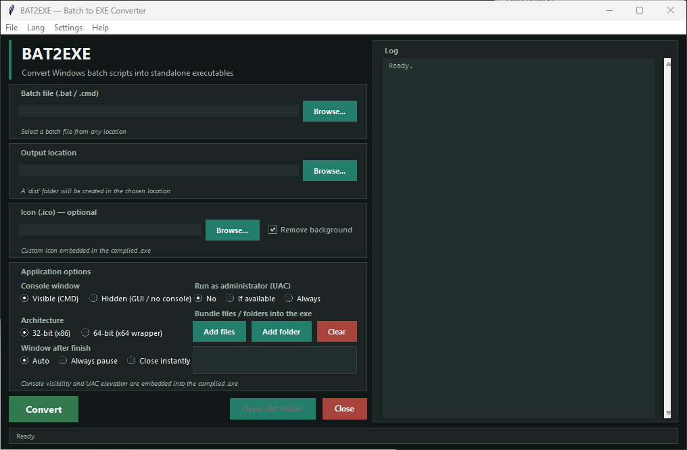

# BAT2EXE

<p align="center">
  
</p>

<p align="center">
  
  
  
</p>

**English** | [Polski](docs/readme.pl.md)

BAT2EXE is a Windows desktop application that turns batch scripts (`.bat` and `.cmd`) into standalone executable files. It wraps the bundled JJSoft BAT2EXE converter and provides controls for the console, UAC, exit behavior, icons, architecture, and embedded resources.

## Features

- Convert `.bat` and `.cmd` files into `.exe` files.
- Choose an output directory; the application creates a `dist` subfolder and names the output after the source script.
- Choose whether the generated program shows a console window.
- Set the requested UAC execution level: no elevation, highest available, or always require administrator privileges.
- Control what happens when the batch script finishes: automatic pause, always pause, or close immediately.
- Build the default 32-bit output or an x64 launcher containing the 32-bit payload.
- Add an optional icon from `.ico`, `.png`, `.jpg`, `.jpeg`, `.bmp`, `.gif`, `.webp`, `.tif`, or `.tiff` files. Background removal is available for supported images.
- Embed additional files and folders as executable resources.
- Review conversion messages in the built-in log and switch the interface between English and Polish.
- Use the interactive terminal wizard instead of the GUI.

## Requirements

- Windows. The converter and post-build operations use Windows executable and resource APIs.
- Python 3.10 or later with Tkinter available.
- The bundled converter at `modules/BAT2EXE.EXE`.
- Pillow for image conversion and background removal. It is optional if you do not use icon processing.
- A .NET Framework C# compiler (`csc.exe`) available on the system for features that compile a helper to embed icons/resources or build the x64 launcher. If it is unavailable, those post-build operations may fail or be skipped.

The legacy JJSoft converter may also require a compatible .NET Framework runtime on the machine. The exact runtime requirement depends on the Windows installation.

## Install and run

1. Download or clone the project and open a terminal in its root folder.
2. Check that Python is available:

   ```powershell
   python --version
   ```

3. Install Pillow to enable the full icon workflow:

   ```powershell
   python -m pip install Pillow
   ```

4. Start the application:

   ```powershell
   python gui.py
   ```

Tkinter is included with most standard Windows Python installations. If the import is missing, rerun the Python installer and enable the Tcl/Tk component.

## Use the GUI

1. Select a `.bat` or `.cmd` input file.
2. Select the output location. The application creates `<output location>\dist\` automatically.
3. Optionally select an icon, choose whether to remove its background, and add files or folders to embed.
4. Set the console, UAC, architecture, and post-run pause options.
5. Select **Convert** and review the log. Use **Open dist folder** when the conversion finishes.

The **Settings → Tool locations** dialog currently displays fields for custom helper paths, but these values are not saved or used by the conversion pipeline yet.

## Terminal wizard

Run the same conversion pipeline interactively from a terminal:

```powershell
python gui.py --configure
```

The short form is also supported:

```powershell
python gui.py -c
```

The wizard asks for the input file, output location, console and pause behavior, optional icon, UAC level, architecture, and any bundled files or folders.

## Tests

The end-to-end tests are Windows-specific. They build batch fixtures, run the conversion pipeline, inspect icons, and execute produced programs. Run them from the project root:

```powershell
python tests/run_tests.py
```

For verbose fixture and test output:

```powershell
python tests/run_tests.py -v
```

The suite requires the bundled converter and the Windows components used by the selected post-build features. Icon tests also need Pillow and an available `csc.exe`.

## Project layout

```text
.
├── gui.py                 # Tkinter GUI and terminal wizard
├── modules/
│   ├── BAT2EXE.EXE        # Bundled JJSoft batch-to-exe converter
│   └── embed_icon.py      # Windows executable post-processing
├── docs/
│   ├── screenshot.png
│   └── readme.pl.md       # Polish documentation
└── tests/                 # End-to-end tests and batch fixtures
```

## Notes and attribution

The generated executable contains and runs the selected batch script. Only convert scripts you trust, and consider the privileges configured in the UAC option before sharing the output. Bundled files are embedded as resources; this application does not provide a resource extraction interface.

The bundled conversion engine is JJSoft BAT2EXE.EXE (2010). BAT2EXE also includes post-build code for Windows executable resources. Review the applicable third-party terms before redistributing the converter or generated artifacts.

No `LICENSE` file is included in this repository, so no open-source license is stated here. For project questions, contact [Sebastian Januchowski](mailto:polsoft.its@mail.com) or visit [polsoft-it on GitHub](https://github.com/polsoft-it).