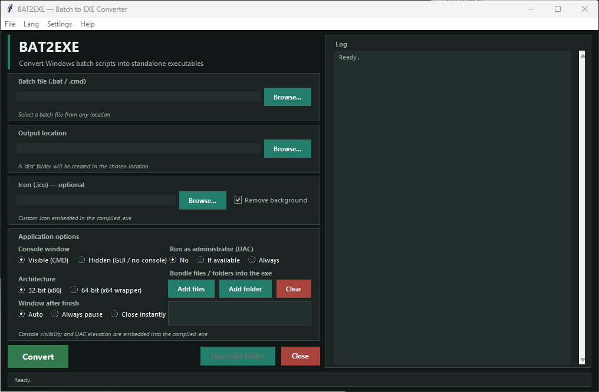

# BAT2EXE

<p align="center">
  
</p>

<p align="center">
  
  
  
</p>

[English](../README.md) | **Polski**

BAT2EXE to aplikacja dla systemu Windows, która zamienia skrypty wsadowe (`.bat` i `.cmd`) w samodzielne pliki wykonywalne. Korzysta z dołączonego konwertera JJSoft BAT2EXE i pozwala ustawić konsolę, UAC, zachowanie po zakończeniu, ikonę, architekturę oraz zasoby osadzane w pliku EXE.

## Funkcje

- Konwersja plików `.bat` i `.cmd` do `.exe`.
- Wybór lokalizacji wynikowej; program automatycznie tworzy w niej podfolder `dist` i nadaje plikowi nazwę skryptu źródłowego.
- Wybór, czy program wynikowy ma wyświetlać okno konsoli.
- Ustawienie poziomu UAC: bez podnoszenia uprawnień, najwyższe dostępne albo zawsze wymagaj uprawnień administratora.
- Wybór zachowania po zakończeniu skryptu: pauza automatyczna, zawsze lub natychmiastowe zamknięcie.
- Domyślny plik 32-bitowy albo otoczka x64 zawierająca 32-bitowy program.
- Opcjonalna ikona z pliku `.ico`, `.png`, `.jpg`, `.jpeg`, `.bmp`, `.gif`, `.webp`, `.tif` lub `.tiff`. Dostępne jest usuwanie tła obsługiwanych obrazów.
- Osadzanie dodatkowych plików i folderów jako zasobów pliku wykonywalnego.
- Dziennik konwersji oraz możliwość przełączenia interfejsu między angielskim i polskim.
- Interaktywny kreator terminalowy jako alternatywa dla GUI.

## Wymagania

- Windows. Konwerter i operacje po kompilacji korzystają z windowsowych plików wykonywalnych oraz API zasobów.
- Python 3.10 lub nowszy z dostępnym Tkinterem.
- Dołączony konwerter `modules/BAT2EXE.EXE`.
- Pillow do konwersji obrazów i usuwania tła. Jest opcjonalny, jeśli nie korzystasz z przetwarzania ikon.
- Dostępny w systemie kompilator C# z .NET Framework (`csc.exe`) dla funkcji, które kompilują pomocniczy program do osadzania ikon/zasobów lub tworzenia otoczki x64. Bez niego te operacje mogą się nie powieść lub zostać pominięte.

Starszy konwerter JJSoft może również wymagać zgodnego środowiska uruchomieniowego .NET Framework. Dokładne wymaganie zależy od instalacji Windows.

## Instalacja i uruchomienie

1. Pobierz lub sklonuj projekt i otwórz terminal w jego folderze głównym.
2. Sprawdź dostępność Pythona:

   ```powershell
   python --version
   ```

3. Zainstaluj Pillow, aby włączyć pełną obsługę ikon:

   ```powershell
   python -m pip install Pillow
   ```

4. Uruchom program:

   ```powershell
   python gui.py
   ```

Tkinter jest dostępny w większości standardowych instalacji Pythona dla Windows. Jeśli brakuje tego modułu, uruchom ponownie instalator Pythona i zaznacz składnik Tcl/Tk.

## Konwersja w GUI

1. Wskaż wejściowy plik `.bat` lub `.cmd`.
2. Wybierz lokalizację wynikową. Program automatycznie utworzy `<lokalizacja>\dist\`.
3. Opcjonalnie wskaż ikonę, zdecyduj o usunięciu tła i dodaj pliki lub foldery do osadzenia.
4. Ustaw opcje konsoli, UAC, architektury oraz pauzy po uruchomieniu.
5. Wybierz **Konwertuj** i sprawdź dziennik. Po zakończeniu użyj **Otwórz folder dist**.

Okno **Ustawienia → Lokalizacje narzędzi** wyświetla pola niestandardowych ścieżek do narzędzi pomocniczych, ale te wartości nie są jeszcze zapisywane ani wykorzystywane przez proces konwersji.

## Kreator terminalowy

Ten sam proces konwersji można uruchomić interaktywnie w terminalu:

```powershell
python gui.py --configure
```

Dostępny jest również krótszy przełącznik:

```powershell
python gui.py -c
```

Kreator pyta o plik wejściowy, lokalizację wynikową, konsolę i pauzę, opcjonalną ikonę, poziom UAC, architekturę oraz pliki i foldery do osadzenia.

## Testy

Testy end-to-end są przeznaczone dla Windows. Tworzą pliki testowe, uruchamiają proces konwersji, sprawdzają ikony i uruchamiają wygenerowane programy. Uruchom je z folderu głównego projektu:

```powershell
python tests/run_tests.py
```

Szczegółowe informacje o testach i plikach testowych:

```powershell
python tests/run_tests.py -v
```

Testy wymagają dołączonego konwertera oraz składników Windows potrzebnych wybranym funkcjom po kompilacji. Testy ikon wymagają też Pillow i dostępnego `csc.exe`.

## Struktura projektu

```text
.
├── gui.py                 # GUI Tkinter i kreator terminalowy
├── modules/
│   ├── BAT2EXE.EXE        # Dołączony konwerter JJSoft
│   └── embed_icon.py      # Modyfikowanie plików EXE w Windows
├── docs/
│   ├── screenshot.png
│   └── readme.pl.md       # Polska dokumentacja
└── tests/                 # Testy end-to-end i pliki testowe
```

## Uwagi i autorstwo

Wygenerowany plik wykonywalny zawiera i uruchamia wybrany skrypt wsadowy. Konwertuj tylko zaufane skrypty i przed udostępnieniem pliku sprawdź ustawienia uprawnień UAC. Dodatkowe pliki są osadzane jako zasoby; program nie udostępnia interfejsu do ich wypakowywania.

Dołączony silnik konwersji to JJSoft BAT2EXE.EXE (2010). Projekt zawiera również kod modyfikujący zasoby plików wykonywalnych Windows. Przed redystrybucją konwertera lub wygenerowanych plików sprawdź warunki licencji odpowiednich składników.

Repozytorium nie zawiera pliku `LICENSE`, dlatego nie deklaruje tu licencji open source. Pytania dotyczące projektu można kierować do [Sebastiana Januchowskiego](mailto:polsoft.its@mail.com) lub na [profil polsoft-it w GitHub](https://github.com/polsoft-it).